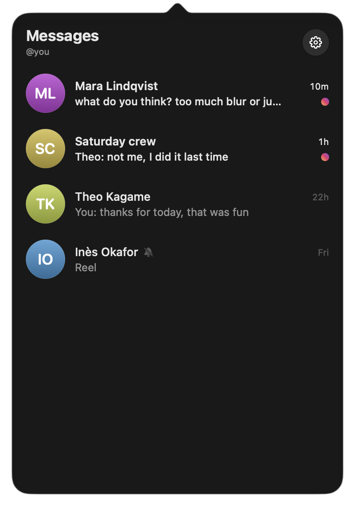
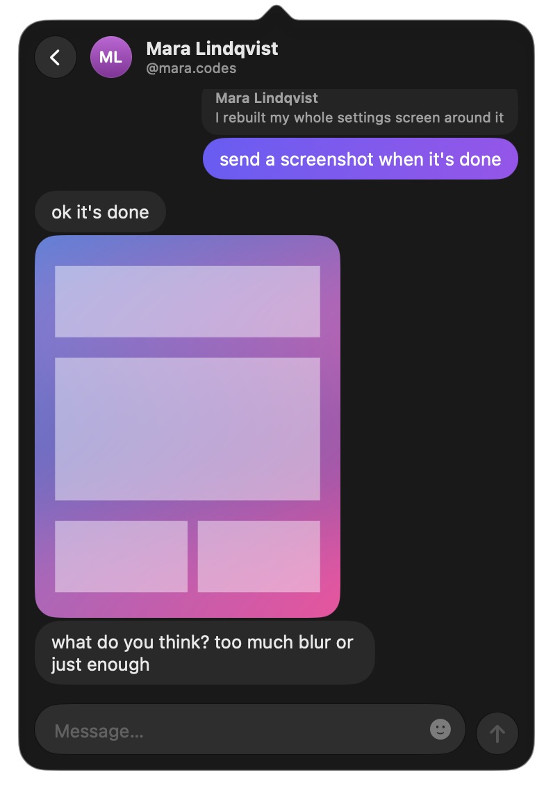
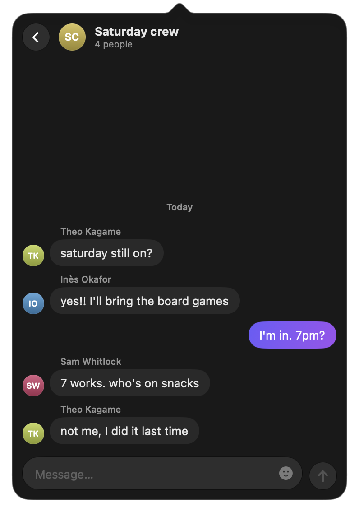
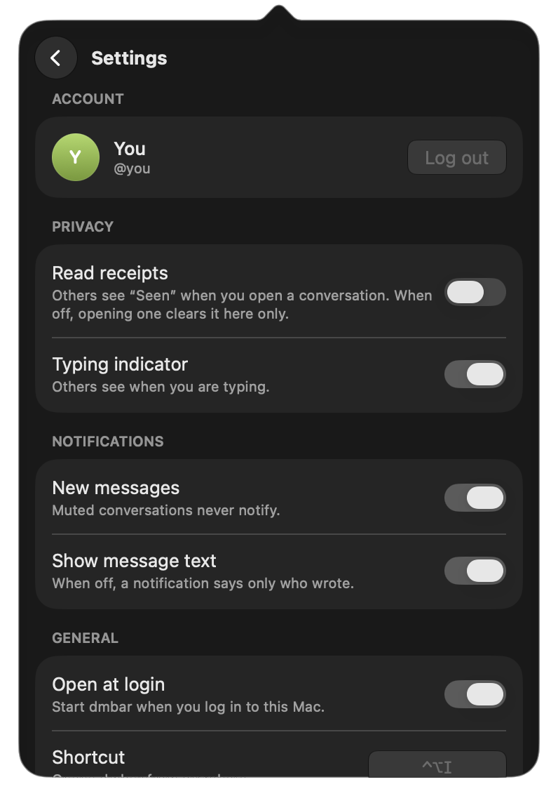

<h1 align="center">dmbar</h1>

<p align="center">
  Instagram DMs in the macOS menu bar.<br>
  Read, reply and react from a small native popover, with notifications you can answer inline.
</p>

<p align="center">
  
  
  
</p>

<p align="center"><sub>Screenshots use the built-in demo inbox: the people and messages are made up.</sub></p>

> [!WARNING]
> dmbar uses Instagram's unofficial web protocol, which Instagram's terms don't allow. The account can be challenged or locked. It is a personal project, not affiliated with Instagram or Meta, and there are no release builds: you build it yourself.

## What it does

- **Inbox and conversations:** the inbox, full history paged in as you scroll, group chats, read state and typing indicators both ways.
- **Replying:** send text, quote-reply, react and see reactions. Notifications carry an inline reply field.
- **Media:** photos, GIFs, stickers and videos show in the conversation and open in a viewer. View-once media, reels, shared posts and voice notes show as a labelled placeholder.
- **Emoji:** a picker in the composer, or type `:fire:` the way Slack and GitHub do.
- **Privacy switches:** read receipts and your typing indicator can be turned off. With receipts off, opening a conversation clears it on your Mac and tells Instagram nothing.
- **Gets out of the way:** lives only in the menu bar, opens from anywhere with ⌃⌥I, and still works when a menu bar manager hides the icon.

Not there yet: starting a new conversation, message requests and sending media.

<p align="center">
  
</p>

## Install

You need an Apple silicon Mac on macOS 26 or newer, Go 1.26 or newer and Xcode 26 or newer.

```sh
git clone https://github.com/rcnsh/dmbar
cd dmbar
make install    # builds dmbar.app, copies it to /Applications and opens it
```

Log in on Instagram's own page from the welcome screen. The session is kept on your Mac, encrypted under a key in your Keychain, in `~/Library/Application Support/dmbar`. The daemon's log is `~/Library/Logs/dmbar/dmbard.log`.

The build is signed with your Developer ID if one is in your keychain, and ad hoc otherwise.

## How it fits together

dmbar is two programs. `dmbard` is a Go daemon that logs in to Instagram, keeps the live connection up and serves a small HTTP API on loopback. The app in `app/` is native Swift and SwiftUI with Liquid Glass. It starts the daemon and talks only to that API.

```
app/                the menu bar app (SwiftUI in an NSPopover)
      │  HTTP + server-sent events on 127.0.0.1, bearer token   → docs/api.md
cmd/dmbard
      │
internal/api        JSON and event stream
internal/engine     one account: login, reconnects, inbox in memory, event fan-out
internal/session    the login on disk, encrypted under a Keychain key
internal/instagram  the Instagram backend, taken from termeownal
internal/core       the types and interfaces between the two, taken from termeownal
      │
go.mau.fi/mautrix-meta/pkg/instameow   the protocol itself (upstream)
```

The protocol code is Go and changes upstream every month, so it stays in its own process: when Instagram changes something, updating `mautrix-meta` is usually the whole fix. Nothing is cached on disk. The daemon starts cold, keeps the first inbox page in memory and fetches history on demand.

## Development

```sh
make check      # gofmt, vet, Go tests with the race detector, Swift tests
make app-demo   # the built app on a made-up inbox, popover open; no account needed
```

`DMBAR_ROUTE=settings` or a demo thread ID (`101`, `900`) opens `make app-demo` on that screen.

The daemon runs on its own too:

```sh
make run     # 127.0.0.1:7878, token "dev", debug logs
make demo    # the same on a made-up inbox
make build   # bin/dmbard
```

With `make demo` going:

```sh
curl -s -H 'Authorization: Bearer dev' 127.0.0.1:7878/v1/state
curl -N -H 'Authorization: Bearer dev' 127.0.0.1:7878/v1/events
```

To log in by hand with `make run`, copy the `sessionid`, `csrftoken`, `ds_user_id`, `mid` and `ig_did` cookies from a browser logged in to instagram.com:

```sh
curl -s -H 'Authorization: Bearer dev' 127.0.0.1:7878/v1/login/cookies \
  -d '{"cookies":{"sessionid":"…","csrftoken":"…","ds_user_id":"…","mid":"…","ig_did":"…"}}'
```

### Docs

- [docs/api.md](docs/api.md): the HTTP API between the app and the daemon.
- [docs/instameow.md](docs/instameow.md): how the upstream library behaves and how the backend uses it.
- [docs/instagram-ids.md](docs/instagram-ids.md): the thread and user IDs, verified against a real account by termeownal.

## Credits

- **[mautrix-meta](https://github.com/mautrix/meta)** by Tulir Asokan and contributors (AGPL-3.0) speaks Instagram's protocol. It is a Go module dependency, used unchanged.
- **[termeownal](https://github.com/ericliswan/termeownal)** by ericliswan (AGPL-3.0) is where `internal/core` and `internal/instagram` come from, at commit `bb046f1`, with their tests. That code knows how to drive `instameow`: restoring a session, loading the inbox, the three kinds of thread ID, turning Instagram's deltas into events and reconnecting after sleep. Those files keep its copyright notice, and the ones changed for dmbar say so under it.
- **[gemoji](https://github.com/github/gemoji)** by GitHub (MIT) supplies the emoji and their `:shortcode:` names. Its licence is in the header of the generated `app/Sources/Dmbar/EmojiData.swift`.

## Licence

[AGPL-3.0](LICENSE), because `mautrix-meta` and termeownal are. If you run a changed version for other people over a network, you have to offer them its source.
